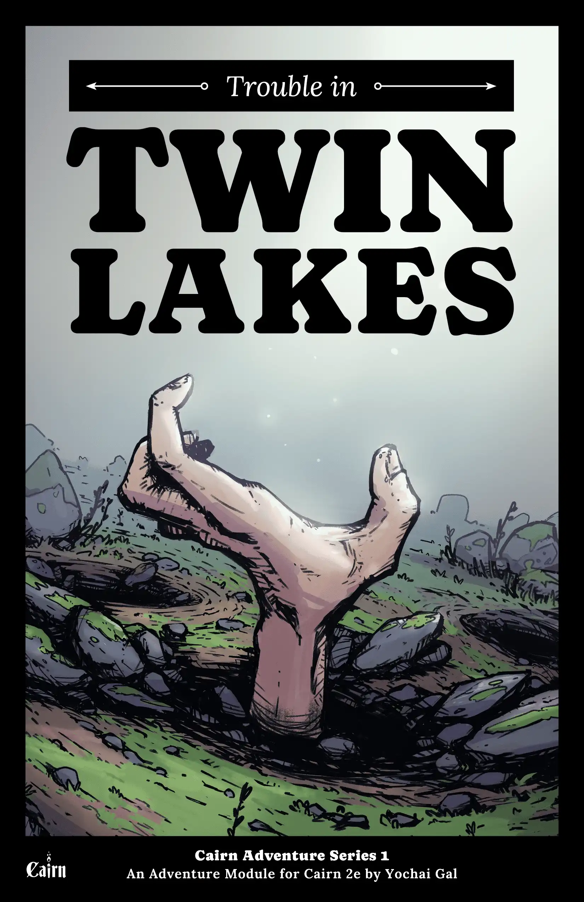
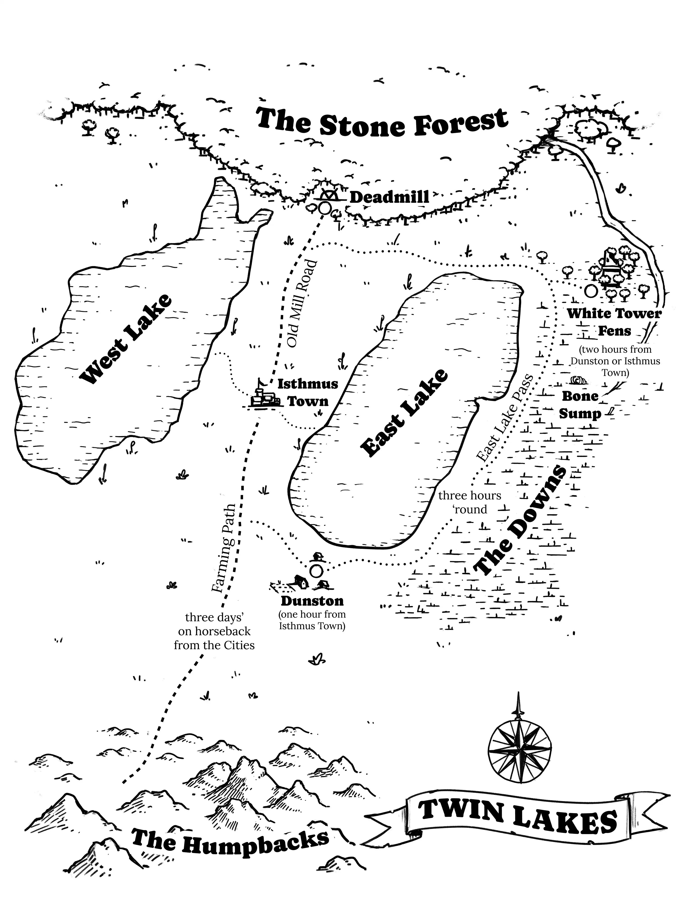
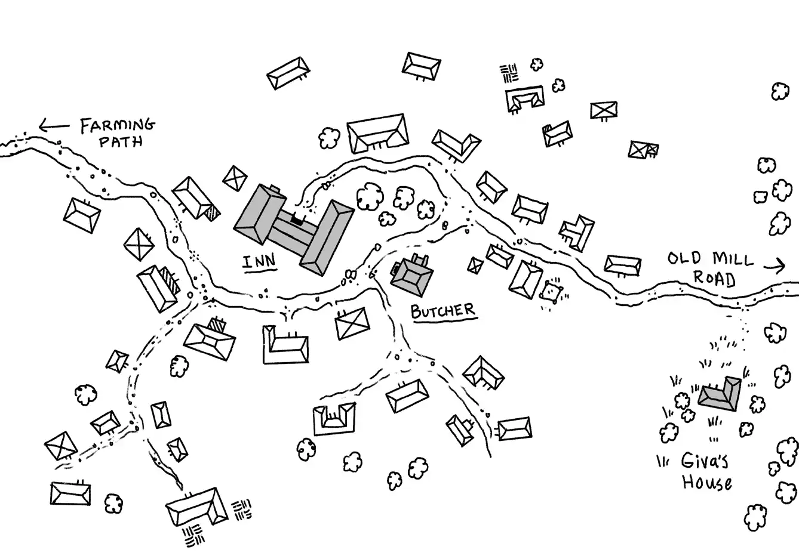
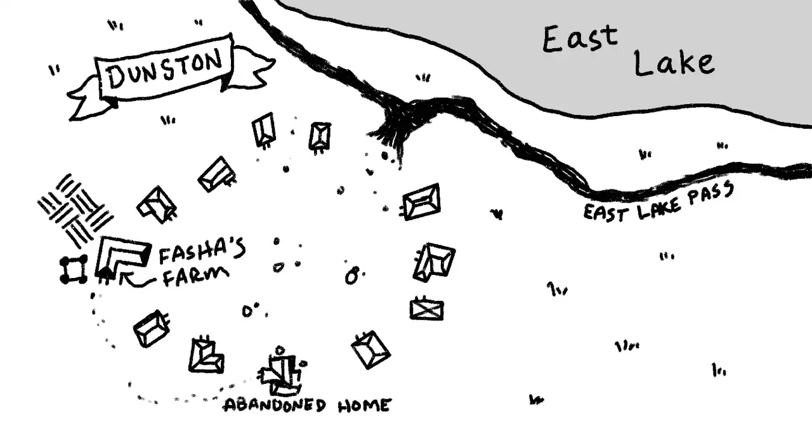
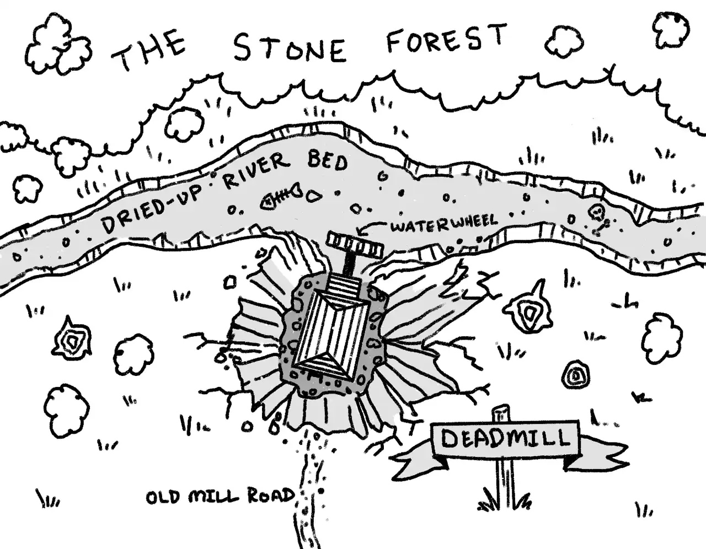
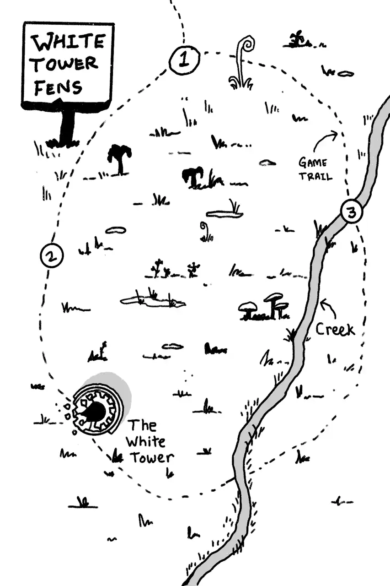
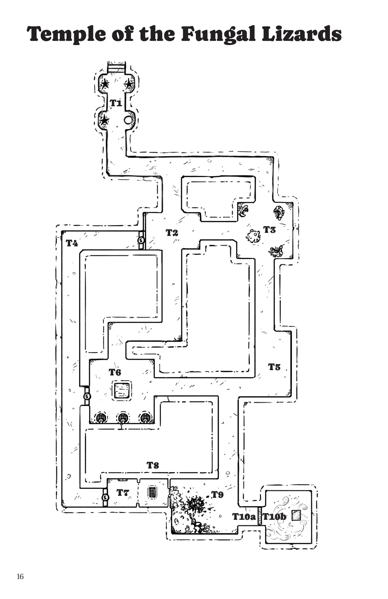
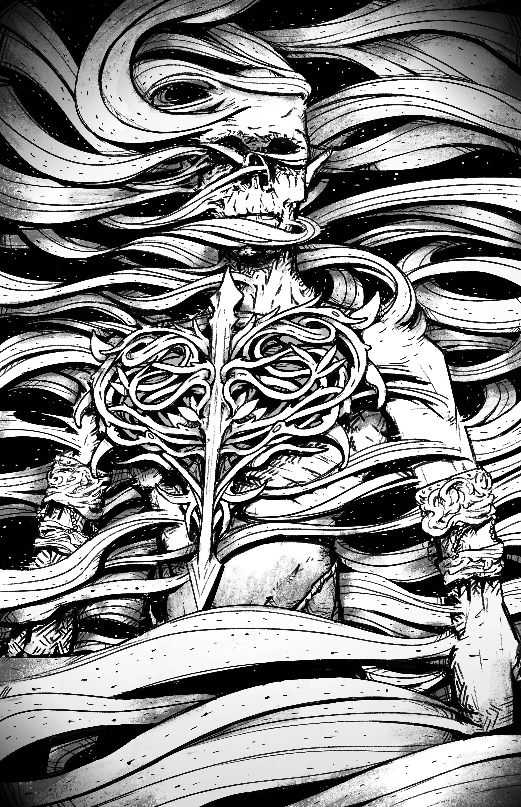
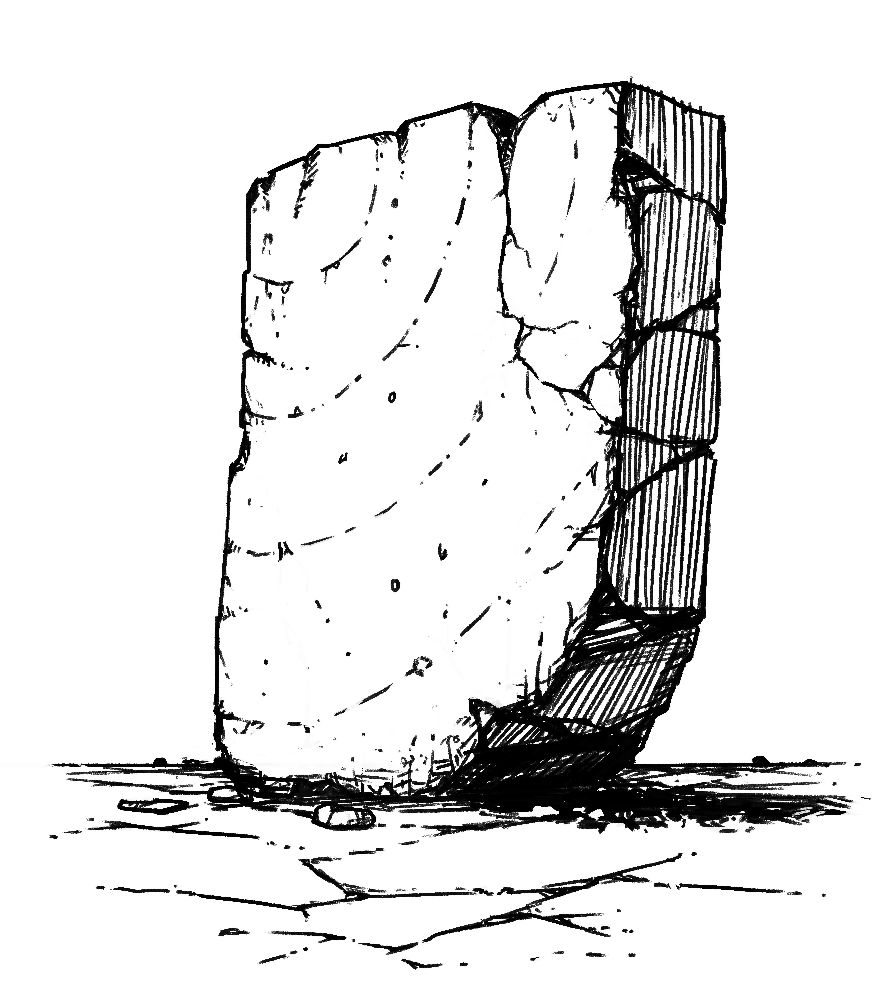

《双湖纷扰》是《石冢》第二版冒险游戏独立冒险系列的第一部。本冒险围绕两桩核心谜案展开，供玩家团队侦破。其中包含形形色色的非玩家角色与敌对势力，以及多处可供探索的地点。本冒险既适合新玩家，也适合老玩家，尤其适合那些仍在荒野与险境中寻找自身定位的角色。尽管本地区及其居民属于更宏大的**瓦尔德**设定，但也可轻松融入你选择的任何低奇幻设定。

**《石冢》冒险系列 1**
《石冢》第二版冒险模组，作者 Yochai Gal

**制作人员：** 撰写：Yochai Gal；编辑：Derek B.；编辑协助：Yossi Krausz；排版与局部地图：Adam Hensley。封面艺术与区域地图：Ari-Matti Toivonen。

由 Cairn Press 出品。

本作品文本采用 [CC-BY-SA 4.0](https://creativecommons.org/licenses/by-sa/4.0/deed.en) 许可协议授权。 

## 引言

CAS-1：双湖纷扰是《石冢》第二版冒险游戏独立冒险系列的第一部。本冒险围绕两桩核心谜案展开，供玩家团队侦破。其中包含形形色色的非玩家角色与敌对势力，以及多处可供探索的地点。本冒险既适合新玩家，也适合老玩家，尤其适合那些仍在荒野与险境中寻找自身定位的角色。尽管本地区及其居民属于更宏大的**瓦尔德**设定，但也可轻松融入你选择的任何低奇幻设定。

## 关于规则与流程
本模组的内容高度依赖《石冢 2e 玩家指南》中呈现的规则与流程，尤其是[核心背景](/players-guide/backgrounds/)与[地城探索流程](/players-guide/procedures/#dungeon-exploration)。然而，由于本冒险中各地点之间距离较远，[荒野探索流程](/wardens-guide/wilderness-exploration/)恐怕用处不大。监守应转而利用本文中提供的各类随机遭遇表。

## 冒险设定
两周前，地峡镇受人爱戴的屠夫**阿尔德拉**突然消失得无影无踪。数日后，一名当地少年声称看见一个男人在**死磨坊**附近被大地吞没。另有其他人也相继失踪。如今镇民们不禁惶惶不安：下一个会是谁？

## 引子
- [潮生者](#tideborn)已同意支付队伍 750gp，以查明阿尔德拉的下落。若能寻回此人的遗体并交还潮生者侍僧妥善安葬，另付 250gp 赏金。出发搜寻前，他们须先到地峡镇的屠夫铺与弗拉维娅会面。
- 城邦方面悬赏每人 200gp，凡能协助寻获詹迪者皆可领取。詹迪是一名什一税吏，本应数日前带着最新税款归来。唯有税款完好无损、账目清楚，队伍方能获得赏金。队伍须先在饱腹客栈与长官特雷利斯会面，再展开搜寻。
 

## 真相究竟如何？
乍看之下彼此关联的种种事件，实则只是*纯粹的巧合*。阿尔德拉的命运与死磨坊那名男子完全无关。尽管《瓦克归来》与《被吞之人》共享部分角色与地点，但先前发生的事件彼此毫无干系。

## 瓦克归来

### 六个月前
法夏大半辈子都是个怯懦自私的农夫，在**邓斯顿**勉强度日。他曾一度是长官特雷利斯的左右手，常帮他窃取本应上缴诸城的什一税，并趁夜深人静将部分赃物藏于**邓斯顿**的**废弃宅邸**。

某日，法夏行经**骸骨洼地**附近，听见一名女子的声音自水下呼唤他。那声音自称瓦克，恳求他解救自己。法夏应允，作为回报获赐**瓦克之眼**。

### 如今
两周前，法夏与长官的深夜勾当引起了当地屠夫**阿尔德拉**的注意。他尾随二人回到邓斯顿，想当场捉住他们。但法夏早有防备，伏击了屠夫，将他拖入**[真菌蜥蜴神庙](#temple-of-the-fungal-lizards)**。在那里，他的心脏被扯出体外，由瓦克吞食。尽管长官特雷利斯知道阿尔德拉的遭遇是法夏所为，恐惧与自私却令他甘为同谋。 

阿尔德拉失踪已数周。与此同时，瓦克每日索求更多献祭，以加速自己的重生。每隔一晚，法夏便绑架一名受害者，带往**真菌蜥蜴神庙**，让瓦克在次日清晨吞食其仍在跳动的心脏。

## 被吞噬者

### 一周前
**詹迪**是一名缮写师，常代表诸城前往**地峡镇**征收什一税。数月来，他一直在撰写一部关于本地区的简史，走访当地居民，探访各处文化遗址。作为这项研究的一部分，他在冒险开始前一周造访了**[死磨坊](#deadmill)**。不幸的是，詹迪赶上的是一处遍布天坑与流沙的地方。

詹迪不知危险，陷入流沙而死。然而，由于他离**回响火花**很近，他被复活了，却对死亡毫无记忆。随后他再次踏入流沙，继续着无尽的死亡循环。

次日夜里，当地少年**德拉姆**目睹大地在死磨坊将一名男子整个吞没。距满月仅剩两天，关于有邪祟作乱的传言正迅速蔓延。

### 如今
数日后，石之森的蛙巫**安娜弗拉纳克斯**来到死磨坊，取回磨石之下名为[回响火花](#echo-spark)的时间循环装置。 

安娜弗拉纳克斯意识到死亡循环中蕴藏的潜力，便将一盏**幽火灯**藏于[附近](#2-the-waterwheel)，借詹迪无尽的痛苦增强被困生物的力量。下一个满月之夜，她将重返死磨坊，把幽火灯抛入流沙。由此迸发的能量将撕开一道通往[根域](#the-roots)的传送门。

## 受害者日程
每天投掷 1d8 以确定选中哪位受害者。

**第 1 天：**无人。
**第 2 天：**在受害者表上投掷。
**第 3 天：**无人。
**第 4 天：**在受害者表上投掷。
**第 5 天：**瓦克于日落时分苏醒。

| d8 | 受害者 |
| --- | --------------------- |
| 1   | 科塞塔（织工） |
| 2   | 吉娃 |
| 3   | 弗朗茨（杂货商） |
| 4   | 德拉姆 |
| 5   | 贝朱（鳏夫） |
| 6   | 长官特雷利斯 |
| 7   | 尼古拉斯（旅人） |
| 8   | 弗拉维娅 |

# 重要 NPC

## 长官特雷利斯
魅力十足，颇受欢迎，粗犷英俊。说话带着做作的拖腔，总记不住别人的名字。饱腹客栈的店主，最近当选处理镇务。

- 尽可能避开 PC，但若他们对阿尔德拉表现出兴趣，便会与他们作对。
- 他知道詹迪从未前来取走十一税，但任何关于此人遗物的追问都会被引向德拉姆——他在詹迪下榻的客栈做工。
- 长官办公室里的官方**什一税记录**是伪造的。真正的账目保存在**客栈**的**地下室**里。将这本书与詹迪自己的[什一税记录](#1-interior)对照，也能揭穿他的罪行。
- 若性命受到威胁，他会承认盗取什一税，但绝不承认谋杀阿尔德拉。

## 法夏
来自邓斯顿的农夫，昔日孱弱粗鄙，如今戴上[瓦克之眼](#the-eye-of-vuk)后，沉醉于新得的力量与洞察。

> 
> **法夏 (Fascha)**
> **14 力量** · **13 敏捷** · **5 意志**
> *攻击*：拳头（d8+d8），钩刀（d6）
> *行动*：必要时逃往白塔沼泽引追兵触发陷阱；一有机会便将败者拖入真菌蜥蜴神庙献祭。

- 必要时他会逃往**白塔沼泽**，指望追兵触发他布下的陷阱。
- 一有机会，他便会将任何被击败的对手拖往[真菌蜥蜴神庙](#temple-of-the-fungal-lizards)献祭。

## 阿尔德拉
一名魁梧而受人爱戴的屠夫，虔诚的潮生者，弗拉维娅的丈夫。二人共同经营屠夫铺。

- 遇害当晚，阿尔德拉正在桌前工作，忽见长官提着大包从[地窖活板门](#cellar)出来。他悄悄溜出，生怕惊醒妻子，尾随长官而去。当夜稍晚，法夏将瘫软的阿尔德拉拖至骸骨洼地杀害，喂给了[瓦克](#vuk)。

## 弗拉维娅
阿尔德拉的妻子，肉铺的共同经营者。神情明显悲恸，却强作镇定。

- 她会提到丈夫睡前总会摘下吊坠（上面刻着三道斜向的波纹），而她到处都找不到它。
- 两周前最后一次见到丈夫。她上床时，他正像往常一样在桌前数钱，常常熬到深夜。她把他未写完的账本收在**[书桌抽屉](#butcher-shop)**里。抽屉钥匙挂在她颈间一条不起眼的小银链上。 
- 若问起法夏，她会说自己听过传言，那人常在深夜去**东湖隘口**散步。她极厌恶此人，称其粗鲁傲慢。
- 若有人问起吉娃，她会提到，尽管阿尔德拉是个脾气暴躁、迷信的老妪，却觉得她颇有魅力。

## 詹迪
一位中年、不修边幅的缮写师，兼任诸城什一税吏。他定期造访地峡镇，向长官特雷利斯征收什一税。他乘马驾车自由往来，因为绝不会有强盗胆敢袭击身披诸城号衣之人。  

- 他在饱腹客栈常年包有一间房，但按计划本应在造访死磨坊的同一天离开。然而，他的马和马车仍留在村中马厩。
- 他与吉娃交好，曾为撰写一部本地区往事的著作而采访过她。
- 若获救，他会说，自己最后的记忆是初次从西侧入口进入这栋建筑。他透过东窗望见磨坊精良的桨轮，便从南门出去查看。他未察觉流沙，失足陷入，就此死去，随后又在磨坊内重生。
- 他的侧袋里存有一份什一税记录。

## 吉娃
地峡镇最年长的人。即便在最好的日子里也多半脾气暴躁，她不喜欢大多数人，尤其憎恶法夏。她是德拉姆的姑祖母。 

- 她喜欢詹迪，他偶尔会就“旧日时光”采访她。几天前他错过了两人约定的最近一次拜访；她上次与他交谈时，他说自己打算去探访本地区几座古老的伐木磨坊。他本应到那天下午才动身，但她猜想定是有急事把他召回了诸城。  

## 德拉姆
一个爱挖苦人的瘦高少年。吉娃是他的姑祖母。他在饱腹客栈做下午和晚间的活计。

- 他觉得，自己离开地峡镇的唯一出路就是尽可能多攒金币。他认为长官特雷利斯是个骗子。 
- 若有人问起詹迪，他会指出那人的马和马车仍留在马厩。
- 他在死磨坊目睹了怪事，愿意开口，但要价（15gp）。 
	- 他会告诉玩家角色们，几晚前他参加了一场游戏，当地青少年争相比试，看谁能背对磨坊西侧入口、站在老磨坊路上坚持最久。他是最后一个留下的，直到听见身后传来一声“砰”响才放弃。他转过身，看见一个男人从磨坊南侧入口走出，随即被前方的地面吞没。那男人看着有些眼熟，但绝对不是本地人。

## 安娜弗拉纳克斯
一位年长的半巫，栖居于石之森深处。她凭幻术与智谋求生，对琐碎的道德不屑一顾。她有意穿越[根域](#the-roots)，主要为寻求新的疗伤之物与失传的魔法。她以真菌为主食，偶尔也吃粗鲁的旅人。

> 
> **安娜弗拉纳克斯 (Anafranax)**
> **9 耐久度** · **11 力量** · **14 敏捷** · **17 意志**
> *法术*：携带以下四本[法术书](/wardens-guide/spellbooks/)（*活化物件、奥术之眼、幻音术、化兽术、迷乱术、加速术、安抚术、推拉斥引、读心术、灌木丛、真实视界、幻影术*）
> *特性*：形貌随听众意图改变；年事已高，尽可能避免战斗；若被杀，石之森每一只鸟都会攻击凶手直至其死亡或逃离。

- 她能依听众及其意图改变形貌。有时是长发赤褐的年轻女子，有时则矮胖得近乎两栖模样。
- 冒险开始两天后的傍晚，她返回死磨坊。尽管她强大无比，却也年事已高，会尽可能避免战斗。 
- 她对森林及其历史了如指掌，能为队伍提供几乎任何病症的解药。她向来言出必行。
- 携带以下四本[法术书](/wardens-guide/spellbooks/)：*活化物件、奥术之眼、幻音术、化兽术、迷乱术、加速术、安抚术、推拉斥引、读心术、灌木丛、真实视界、幻影术。* 
- 若她被杀，石之森的每一只鸟都会攻击凶手，直至其死亡或逃离森林。

# 双湖

这片与世隔绝的地域位于诸城以北，骑马穿过**驼峰岭**仅需数日。**地峡镇**是该地区唯一的主要聚居地，坐落在两片淡水湖之间的狭长地带上。镇南多为农田，唯有已废弃的渔村邓斯顿例外。 

北方是**石之森**，一片广袤的林区，散布着古老的磨坊与伐木小径。**西湖**仍是周边城镇鱼类与饮水的主要来源，尽管此地既无步道，也无天然耕作。蜿蜒的湖畔小径是昔日繁盛的**东湖**仅存的遗迹，如今那里已无鱼可捕，也无洁净饮水。

尽管该地区以相对安全著称，夜间出行仍很危险，因为强盗与夜猫都惯于追击势单力薄的队伍。冒险始于丰收季，恰在最后一茬庄稼收割之后。

| d6 | 路上听闻的传闻 **每当队伍离开地峡镇时投掷 1d6。重复结果重掷。** |
| ----- | ---------------------------------------------------------------------------------------------------------------------------------------------------------------------------------------------------------------------------------------------------------------------------------------------------------------------------------------------------------------------------------------------- |
| **1** | *一个来自邓斯顿的家庭拉着一辆堆满鱼的手推车。*“西湖嘛，钓鱼还行。可跟我那会儿的东湖比起来，差远了。我跟你说，当年木材好的时候，鱼也好。去问问那个老顽固吉娃，她记得。” |
| **2** | *一对年轻的双胞胎朝西湖走去，高高举着钓竿。*只有一人开口。“从前人们常去丘陵上舔青蛙，你知道吧。编出各种疯话，说什么闹鬼之类的。当然，那不是真的。除了白塔沼泽。那地方让我们毛骨悚然。” |
| **3** | *两名工人并排走着，牵着一匹拉车的役马，车上堆满工具和木材。*“是啊，我和我兄弟伯克被雇来修邓斯顿那座老克劳科宅子，就是十年前塌掉的那座，对吧？有点奇怪，毕竟没人告诉我们是谁出的钱。但长官说这位先生是个真正的慈善家，想‘回馈’一下。” |
| **4** | *一名老者坐在镇口，削着一把木刀。*“屠夫那档子事，我看就是那帮潮生者疯子干的。你可知他们连自己人都淹死，只把幸存者纳入门下，却视死者为不配？” |
| **5** | *一位衣着考究的年轻女子向西走去。*“我翻过驼峰岭，就为了见林子里那个蛙女。听说她能治各种毛病……我等着下一个满月去找她。” |
| **6** | *一名猎人拖着一张塞满猎物尸体的大网。他衬衫上有血。*“你最近去过丘陵吗？一阵风从东边吹来，带着一股恶臭，像翻涌的死气。” |

| d6 | 遭遇 **每当队伍在两点之间旅行时投掷 1d6。夜间投掷两次。** |
| ----- | ------------------------------------------------------------------------------------------------------------------------------------------------------------------------------------------------------------------------------------------------------------------------------------------------------------------------------------------------------------------------------- |
| **1** | 吸血虫成群而至，被体温吸引。几乎无法击退，却会主动扑入明火。除非避开，否则所有人增加一次疲乏。 |
| **2** | 一名锅匠骑车同行，满载闪亮的锡器。他主要卖厨具，但若被追问，愿以 100gp 出售包中的[制箭师之怒](#fletchers-ire)。 |
| **3** | 一阵突如其来的狂风裹挟着漂浮的植被，将队伍浇透。每名角色失去一项资源（火把熄灭、口粮掉落、鞋子丢失等）。 |
| **4** | 一名手无寸铁的女子拉着一车鱼箱，请求帮忙把车轮从泥里弄出来。尽管她费了不少力气，衣服却显得相对干净。若队伍停下帮忙，3 名**强盗*** 会从枝叶间跃出伏击。未作准备的 PC 自动豁免失败。车轮脱困后，这辆车（+4 格）状况良好。箱子里空空如也。 |
| **5** | 长满苔藓的沃土化为厚泥，每走一步都发出响亮的噗嗤声。附近的动物因队伍靠近而四散，徒步旅行者增加一次疲乏。 |
| **6** | 一男一女围坐在熊熊火焰旁做饭。他们自称捕蛙人，乐意出售当天的收获：香料蛙腿 2gp，或一瓶蟾蜍分泌物（2 次使用）25gp。后者兼具致幻与某种吐真剂之效。 |

- **制箭师之怒。** 向距钨条三十英尺内的目标发射时，单发远程攻击受损。笨重，三发充能。充能：将钨条浸入熔铅炉，再冷却。

> 
> **强盗头目 (Bandit Leader)**
> **6 耐久度** · **2 护甲** · **13 力量** · **14 敏捷** · **13 意志**
> *武器*：长剑（d10，笨重）
> *士气*：士气检定时使用首领意志；若首领被杀，匪徒撤退。

> 
> **强盗 (Bandits, x2)**
> **4 耐久度** · **1 护甲** · **12 力量** · **12 敏捷** · **9 意志**
> *武器*：剑（d6）；一人持短弓（d6）

# 地峡镇

一座昔日的伐木小镇，如今主要靠从**西湖**捕鱼的收益勉强维持。镇上居民不足三十户。镇上的集市每日上午 8 点至下午 2 点开放，货品与补给颇为可观，包括任何价格低于 10gp 的物品。（见 2e《玩家指南》中的[集市](/players-guide/marketplace/)。）当地特色菜肴包括炸鳕鱼、烤蛙腿和热浆果炖派。渔具（15gp）、沼地鞋（每双 10gp）和防雨衣物（15gp）是热门商品。

## 派系

### 潮生者

一个崇拜里武鲁斯的层级制宗教派系，里武鲁斯是江河湖泊的微末之神。即便是教外之人也熟知该派系的入会仪式——一场偶尔会致参与者溺亡的仪式性溺水。幸存者被称为潮生者，并取一个与水相关的新名号（鲤鱼、芦苇、牛轭湾等等）。只有神职人员需要参与该仪式；然而近年来，他们在乡民中的信众有所增加，尤其是在临近水域的村庄。

### 九人议会

九人议会由商人、学者与权贵组成，凭借雄厚的财富与庞大的间谍网络达成目的。他们的首要事务是奇物的发现、鉴定与管制。近年来，他们将重心转向了根域，因为他们相信根域是大多数奇物的源头，并会为任何关于门扉的情报支付丰厚报酬。

## 饱腹客栈

地峡镇唯一的酒馆，也是旅人唯一能安全歇脚之处。通铺住宿一晚 10gp，含一份洋葱汤与淡啤酒。附属马厩提供基本寄养，每晚 5gp。客栈归长官特雷利斯所有，但大部分实际事务由德拉姆和一位本地厨子操持。

### 外部

建筑呈 H 形，主入口位于东北角。建筑东侧有一扇小**活板门**。西侧有一座小**马厩**。

- **活板门**：正对肉铺二楼窗户的视野之内。活板门被铁链锁在地面上，除非砸断铁链，否则只能从内侧打开。附近的泥土上有脚印。
- **马厩**：四个敞开的栏位，除一个关着一匹马和一辆马车外，其余皆空。
- 德拉姆管理马厩，但每天只查看一次客栈。
- 马匹和马车属于詹迪。两者都带有诸城徽记。

### 内部

酒馆区域很小，仅有三张桌子，垂直于吧台摆放。客房全在二楼，由南侧一段楼梯通达。角落里塞着一间小办公室。它的门几乎总是锁着（只有长官特雷利斯有钥匙），但很容易撬开。酒馆实际上要到下午 3 点才营业，届时德拉姆和厨子会出现，打扫卫生并准备食物。

#### 长官办公室

**饱腹客栈**后方一间阴湿、不适的房间。除了一张**单桌**和一扇上锁的**地窖门**外空无一物。桌上放着一本小**书**。

- **书桌**：只有一个抽屉。里面是一本黑色小册子。这是一份伪造的什一税记录，将其与地下室里的真实记录或[詹迪的挎包](#1-interior)中的副本对比，即可证明长官一直在窃取应缴诸城的什一税。
- **地窖门**：上锁。长官特雷利斯和德拉姆都有钥匙。

#### 地窖

一个狭小阴湿的空间，堆满各种**板条箱**。空气中弥漫着浓重的湿土气息。一张放着各种工具的**工作台**斜靠在一面墙上。东南角的天花板上装有一扇**活板门**和梯子。

- **板条箱**：衣物、家居用品、食物。它们被标记为某座大城的什一税。
	- 这些是给詹迪的，他一周前没能取走。
- **工作台**：家居工具散落在工作台上。 
	- 工作台下方藏有一个暗抽屉。里面是镇上真正的**什一税账簿**。将这本书与楼上办公室的假账簿或詹迪**挎包**中的副本对比，即可证明长官一直在窃取应缴诸城的什一税。 
- **活板门**：向上通往客栈与屠夫之间的巷子。一条粗铁链穿过它，再用一把大铜锁锁住。只有长官特雷利斯有钥匙。

## 肉铺

一栋质朴的两层建筑，紧邻饱腹客栈。北面入口处画着一只无头鸡。一层没有窗户，二层则在建筑四侧各开两扇窗。一条小巷将肉铺与饱腹客栈的东翼隔开。

### 一层

地板上满是木屑与羽毛，踩上去沙沙作响。一块血迹斑斑的巨大**砧板**将空间一分为二。西南角有一道楼梯通往二层。**弗拉维娅**整日待在这里。

**砧板**：一个暗格（由下方的插销开启）存放着当日的收入（1d20 × 当日时辰）。每晚钱款会被取出，锁进楼上的书桌里。 

### 二层

八扇窗户（每个方位各两扇）挂着精致的窗帘。房间东北角占据着一张四柱床，一张精美的木桌安置在里武鲁斯的华丽画像下方。从西南角的楼梯进入。 

- **窗外景色**： 
	- **北面**：吉娃的家，以及**石之森**的景致。
	- **西面**：饱腹客栈，包括地下室的出口。
	- **东面**：东湖的景致，以及远处的白塔沼泽。
	- **南面**：镇广场，以及农耕小径的景致。
- **床**：一张普通的床。床下有一把金柄小匕首（d6），价值 20gp。
- **书桌**：一些文书与书写用具。含一个抽屉（上锁）。 
	- 坐在书桌前，可以清楚地看到饱腹客栈与肉铺之间的小巷，包括那里的地下室出口。 
	- 弗拉维娅把抽屉钥匙挂在颈间的链子上。抽屉里有一本销售账簿和 870gp。账簿只写了一半，正如阿尔德拉失踪那晚弗拉维娅在书桌上发现它时的样子。
- **画作**：一个类人生物（**里武鲁斯**）自水中升起。它身穿白色长袍，袍前刻有三道波浪线。弗拉维娅会说这是几个月前花大价钱买来的。价值 400gp。 

## 吉娃的家

镇北的一座单间棚屋。所用木料比镇上其他建筑更为陈旧、风化。**门**漆成亮紫色，门顶塞着干枯的植物。

- **门**：最近刚漆过。吉娃相信它能驱邪避恶。 
- **植物**：干枯的乌头和其他草药，用以驱避狼人。

### 屋内

一座烧着火的木炉占据了西墙，北侧窗下塞着一张小床。厨房里，桌上摆着两只杯子和一瓶**葡萄酒**。

- **葡萄酒**：非常陈年的佳酿（价值 50gp）。 
	- 吉娃会说她摆出葡萄酒是“为了待客”。她也明确表示，冒险小队并非她所等之人。 
	- 她会承认，她所等的人（詹迪）错过了上次的会面；他本应在近一周前离镇途中顺道来访。

# 农道

一条干燥、踩踏得十分结实的小径，自地峡镇向南延伸，穿过**驼峰岭**，通往更远处的**诸城**。小径两旁散布着小农场和独立田庄。一条小岔路通向**邓斯顿**和**东湖隘口**。

# 邓斯顿

一圈稀稀落落、彼此相隔甚远的破败房屋。这里原是渔村，后来东湖的水变酸了。如今只有穷困的渔夫和倒霉的农夫在此安家。通往**东湖隘口**。

## 法夏的农场

圆环西端矗立着一座破败衰朽的**农舍**。它一侧紧邻残破的畜栏，另一侧是**荒芜的田地**。 

- **畜栏**：三只**绵羊**在附近半塌的畜栏中啃食，饮水槽几乎见底。
- **田地**：枯萎的庄稼与干涸的泥土。看来已数月无人打理。 

### 农舍

一间单室陋屋，内有一只冰柜、一张发霉的床和一个小木炉。地面泥泞，铺满芦苇与杂草。

- **冰柜**：空空如也，显然久未使用。
- **床**：汗渍斑斑的床单上沾满长长的兽毛。
- **炉灶**：灰烬下埋着一个小盒子。内有 130gp 和一枚价值 25gp 的潮生者吊坠。这枚吊坠曾属于阿尔德拉。
- **芦苇**：法夏将阿尔德拉的尸体留在**骸骨洼地**后，从丘陵地带把它们带了回来。 

### 废弃宅邸

圆环东南端的一座破败宅邸。半数屋顶已经塌陷，南墙本应所在之处搭着一块宽大的编织篷布。

- **内部**：空无一物，没有任何家具。**地板**看上去崭新如初。 
	- **地板**：法夏（在长官协助下）雇工翻修了这座宅邸。地板几近完工，但西南角有一处未完工的区域仍可进入，仅容一人半身爬入。
		- 地板下藏着两个大麻袋。白天搬走它们既费时又会引来不少注意。这是法夏分得的什一税（每袋价值 200gp）。

# 老磨坊路

一条连接**地峡镇**与**石之森**的短土路，很快就消失在林中。透过树木可以望见**死磨坊**，恰在林地边缘。若**安娜弗拉纳克斯**[已经归来](#now)，树林与磨坊都将消失，取而代之的是一个巨大的天坑。见“**[若异界之门已开启……](#if-the-gate-has-opened)**”。

# 石之森

一片向北无尽延伸的森林，其广袤的疆域止于**大理石海**。数个世纪以来，森林的木材供养着诸城的需求，直到宝石与矿石的诱惑将它们贪得无厌的胃口引向南方。一条小溪从林地边界流出，位于东湖东北方，最终止于**骸骨洼地**。天黑后进入石之森、制造巨大响动，或偏离小径，都会触发一次荒野事件表投掷（见《玩家指南》第 78 页）。本区域将在本系列未来的冒险中详加探索。

石之森中常见的树栖掠食者是夜猫，一种成群狩猎的夜行有袋类动物。它们发动攻击前唯一的警告，是头顶树枝传来的**嗒—嗒—嗒**声，那是它们在协调进攻，目标锁定行军序列中的最后一人。目标必须进行敏捷豁免，否则伤害直接作用于力量。尽管名为夜猫，它们在白天同样会攻击目标。

### 夜猫

聪慧的夜行有袋类，栖居于森林与沼泽。成群狩猎。

> 
> **夜猫 (Nightcats)**
> **6 耐久度** · **9 力量** · **14 敏捷** · **5 意志**
> *攻击*：爪击（d6+d6）
> *突袭*：树枝上传来“嗒—嗒—嗒”预警，锁定队尾（敏捷豁免失败则伤害直扣力量）。
> *致命伤害*：在目标生还状态下开始啃咬（造成 d4 点力量伤害）。

# 死磨坊

森林边缘有一座古老的磨坊，被疯长的树柱所遮蔽。由于树丛近乎恒久的黑暗，当地少年相信它闹鬼。（其实没有。）它半陷于**地面**之中，北侧伸出巨大的**桨叶**，悬在一条干涸的河床之上。从老磨坊路来的人会抵达建筑的南门，而每隔 30 秒便有一名**男子**打开南门。

- **地面**：建筑正缓缓陷入地下，部分地面具有流沙的特性。 
	- 南门并不安全。进行敏捷豁免以脱身。豁免失败会使受害者陷得更深（最多尝试 3 次）。
- **桨叶**：从南侧几乎无法看清，唯有一片桨叶的尖端涂着明亮、未曾褪色的白漆。见（2）。
- **男子**：时间循环的一部分。
	- 每隔 30 秒，磨坊的门便会打开，一名男子（詹迪）从中走出。他迅速回头张望，仿佛听见了什么。最后，他耸耸肩，再次转身，坠入流沙中身亡。他所听见的声音，其实是装置在上一次循环结束后重新充能的声音。
	- 循环可以被打破：要么救下**詹迪**，要么将奇物从石中取出并带离一小段距离。

## 1. 内部

一块巨大的**磨石**占据了房间的大部分空间，与某些金属**机械**相连。南墙边靠着一只小皮革**挎包**。这座建筑正在缓缓**下沉**。

- **磨石**：仔细搜寻会在石下发现一件泛着微光的金属物件。 
	- [回响火花](#echo-spark)被困在循环之中，既因磨石的重量，也因詹迪的反复死亡。它的能量被不断恢复，又不断耗尽。 
- **机械装置**：转动磨石的木制杠杆已经腐朽，因此无法用此装置转动磨盘。 
- **挎包**：属于詹迪。内有一把匕首（d6）、一本**笔记本**、一份**什一税记录**、口粮（剩 2 次使用）、一支火把（剩 3 次使用）以及 23gp。 
	- **笔记本**：记载着该地区的简史，以及若干对**吉娃**的采访片段。其中有一节题为“木材贸易史”。
	- **什一税记录**：这份副本与饱腹客栈地下室中的另一份之间存在出入。 
- **下沉**：建筑南侧已有一半陷入地下。若同时有超过三人（包括詹迪）身处磨坊内，它便会完全沉入地底（进行敏捷豁免以逃脱或完成任何值得一提的事）。

## 2. 水车

一对结实的**水车桨叶**静止不动。河床完全干涸，满是**枯叶**和其他碎屑。 

- **船桨**：毫无腐朽迹象，漆色洁白如初绘之时。调查会发现两支桨上都刻有**古怪铭文**。 
	- 手动推动船桨可带动内部的**磨石**转动，恰好足以从下方取出**奇物**。此过程至少需要两名壮劳力。
- **铭文**：一段古语，唯有吉娃、詹迪或通晓古代文本之人方能解读。其上写道：“启动之法，逆时针旋转。”
- **落叶**：在残骸与干燥腐殖质中半掩着一只保存完好的便携**铁笼**。
	- 这铁笼实为幽火灯，安娜弗拉纳克斯在其中困住了一缕幽火。它在此已逾一周，汲取着詹迪的诸多死亡。幽火已长得如此之大，铁笼几乎容不下它。与铁接触对幽火而言极为痛苦，因此它几乎时刻处于煎熬之中。它只求自由，以及复仇。若在安娜弗拉纳克斯归来前获释，它会径直飞向女巫的居所，在复仇的尾迹中留下一路火焰。

# 东湖隘口

一条湖畔小径，灌木与湿草蔓生。沿**东湖**蜿蜒，穿过**丘陵**，再向西通往**老磨坊路**。

# 丘陵

一片泥泞恶臭、雾气笼罩的沼泽，也是恐怖故事的常见来源（皆属虚构）。此地仅栖息着蛙、鱼与鸟。泥沼与恶臭之中沉积着大量尸体，既有动物，也有偏离小径者。徒步旅行的队伍**增加一次疲乏**。

# 白塔沼泽

丘陵以东的一片小树林。因其中被附近沼泽雾气笼罩的废弃白塔而得名。经由**东湖隘口**在通往**老磨坊路**的岔口进入。

## 1. 哨木

一根几乎看不见的细线横跨小径，系于两树之间。若被碰断，它会发出只有动物能听见的高频声响。

## 2. 陷坑术

落叶与碎屑之下藏着一处小陷坑，坑底密布着削尖的木桩（d6 力量伤害）。

## 3. 滚木陷阱

一根小圆木横架在小溪之上，看似便于通行。一旦中央受力，圆木便会旋转，将受害者大声甩入下方溪中，溪水里满是**刺苔**。

- **刺苔**：含有麻痹毒素。接触皮肤会使受害者陷入匮乏，其攻击受损，持续 1d4-1 小时。 

## 白塔

一座高 40 英尺的残破塔楼，色白如雪。塔身一侧靠着一架粗木梯。塔的**上部**已完全缺失。

### 攀上木梯

塔的**底部**笼罩在黑暗中，光滑的白墙在光线下**闪闪发亮**。内部没有任何植物生长。 

- **底部**：一种粘稠的琥珀色液体形成四英尺深的池子，填满了塔基。
- 里面有什么东西**闪闪发光**。 
	- **液体**：一种只伤及血肉的酸液（接触造成 4 点力量伤害）。放入其中的其他材料均不受损，若完全浸没则可完好保存。该物质极易燃，片刻间便燃烧殆尽，其中的物品毫发无伤。 
	- **闪光**：一具远古时代的披甲骷髅，仍穿着保存完好的链甲。其腰带上挂着一袋古金币（82gp）和一条破损的丝绳（42 英尺）。  
- **闪烁**：塔底酸液留下的残渍。触之油腻，刺痛如荨麻。

## 骸骨洼地

小溪在距白塔沼泽南面仅几分钟步程处汇入一片小沼泽。**腐臭**气息弥漫此地。沼泽西端有一大**土丘**，由野草与腐屑堆成。此地不见于任何地图，唯有法夏与吉娃知晓。

- **气味**：落入沼泽黏稠溶液中的动物很快便会溺毙，甚至饿死。此处尸体众多，腐烂程度各异。
	- 阿尔德拉的尸体也在其中，漂浮于芦苇之间。沼泽独特的化学环境将其完好保存。他的胸膛被撕开，心脏已被取走。
- **土丘**：看起来是刚堆成的。拨开碎屑，露出一组通往沼泽下方地底的阶梯。这是**真菌蜥蜴神庙**的入口。楼梯间散发着泥土气息，略带花香。
	- 这座神庙实为一艘建筑般大小的甲虫形飞船。入口即其“头部”。
	- 阶梯井内壁齐眼高处装有两盏壁灯，各嵌有一枚菱形物件。物件可取下，价值不菲（150gp，笨重）。它们是灯具，由 **[T7. 灯室](#t7-light-room)** 控制，目前处于关闭状态。

# 真菌蜥蜴神庙

## 通用信息
- **无光**。每个房间的角落都伸出带有菱形物件的壁灯（见 **[T7. 光室](#t7-light-room)**）。它们目前是熄灭的。 
- 墙壁与地板漆成蓝黑色，由一种异域合金制成。寻常武器无法将其凿裂或击碎，但火焰与爆炸粉末能起一定作用。
- 两只**苏拉鲁斯**在神庙中游荡。它们会出现在《石冢》第二版**地下城事件**表的**遭遇**与**环境**结果中。

## T1. 前厅

**东**墙与**西**墙均凿有小龛，各设一座齐腰高的基座。除东南角仍空置外，其余各处均熔铸有小型**雕像**。

- **雕像**：每座均可拧下，但会发出极大噪音。每座价值 50gp。 
	- 西北雕像：一簇球状卵，由一只覆鳞的手托着。
	- 西南雕像：一簇真菌孢子，生长在一根盐状柱子上。
	- 东北雕像：一枚巨大的、布满脉络的孢子。其中隐约可见某种爬行动物的轮廓。
	- 东南雕像：一枚铜色圆环，是这里曾经存在之物的唯一残留。

## T2. 骨灰龛室

一条狭窄的走廊将房间一分为二，两侧各嵌有壁龛。北侧堆放着成摞的**纸**制品，南侧则排列着一排排缺口的**陶器**。西南墙上，两道巨大的水平**接缝**平行排列，相距数尺。 

- **纸**：无用的枯萎卷轴与蛋壳碎片堆叠在一起。 
	- 在残骸之下埋着一根鳞皮制成的小管。里面塞着一只**噬水简**。
- **陶器**：古老的瓮成堆摆放。全部搜寻至少需要两回合。（角色可以分工进行。） 
	- 第一排的一只罐中装着一具脆弱鸟形生物的干尸。它只对专门买家有价值（150gp）。
	- 后方有一只不起眼的瓮，牢牢固定在壁龛上。拧动其顶部可打开**通往 [T4](#t4-maintenance-tunnel) 的舱门**，但会发出极大的噪音。（在地城事件表上投掷。）
- **接缝**：一道通往 **[T4](#t4-maintenance-tunnel)** 的舱门。接缝太窄，撬棍或刀刃都无法插入，且视野内没有明显的把手、按钮或拉杆。

### 噬水简
- 一个圆柱形物体，最多可吸收一整车的水（约 1000 加仑）。1 充能。 
- **充能**：置于任何形式的干燥环境中一个月零一天。

## T3. 繁育室

巨大的**真菌**从散落在地板上的三个囊中萌发。除一个外其余都已破裂，留下巨大的**孔洞**。第四个**结节**完好无损。

- **真菌**：苏拉鲁的胚胎室。有学识者会注意到，它们似乎已在数周前破裂。
- **结节**：体积是其他结节的两倍。它搏动着，散发出微弱的热量。
	- 内含一只发育完全的**苏拉鲁**，随时准备孵化。若附近发出巨响，或在副本事件表上进行遭遇投掷，囊状物便会爆开。若被唤醒，它会攻击视野内的任何生物，因为幼体常会吃掉未孵化的同胞。

## T4. 维护隧道

连接 **[T2](#t2-columbarium)** 与 **[T6](#t6-waste-disposal)**、**[T7](#t7-light-room)** 的灰色荒芜走廊。每条走廊的尽头都伸出 U 形铁杆。扭动铁杆，即可打开通往各处的舱门。在中央走廊，一块长**布**被碎石覆盖。

- **布料**：残骸中有一具保存完好的高大鸟形类人生物骸骨，头戴一顶红色小冠。它的喉咙被撕开，身上裹着**[月布](#moon-cloth)**。它携带着一把小巧的**[弯匕首（d6）](#curved-dagger-d6)**，上面镶有一颗红宝石。

## T5. 符文大厅

东墙布满繁复的**雕刻**。 

- **雕刻**（自上而下依次为）：
	- 人形身影站在塔上，指向一个从天而降的物体。那物体看起来像一只巨大的甲虫。
	- 戴着巨大头饰的高大、生有双翼的身影从“甲虫”前部的一个洞中涌出。紧随其后的是一对蜷伏的蜥蜴状生物。 
	- 蜥蜴状生物撕碎了旁观的人形身影，并淹没了高塔。
	- 生有双翼的身影立于一群跪伏的人形身影之上，它们的蜥蜴“宠物”侍立一旁。

## T6. 废物处理区

这间方形房间的中央是一口齐腰高的方形**井**。南墙伸出三个**喷嘴**，四处不见任何控制装置。每个喷嘴下方都装有**排水口**与格栅。西墙上，两道大型水平**接缝**平行排列，相距数尺。

- **水井**：深达数百英尺。光源照出井底水面上漂浮的古老废弃物。
- **喷嘴**：自动淋浴装置，一旦其排水口承重便喷出滚烫热水。角落灯台发出的一声鸣响是唯一的预警。
- **排水口**：拉起**西南**角的格栅会触发**西**墙上的暗门，开启一道通往 **[T4](#t4-maintenance-tunnel)** 的**密门**。
- **接缝**：一道通往 **[T4](#t4-maintenance-tunnel)** 的暗门。与 **[T2](#t2-columbarium)** 和 **[T7](#t7-light-room)** 中的同类接缝一样，缝隙过窄，撬棍或刀刃无法插入，且不见任何明显的把手、按钮或拉杆。

## T7. 光明室

这间房间**气味**如臭氧。东侧出口处，墙上齐肩高处装有一块小**面板**。**北**墙内嵌着一块菱形**控制板**。西墙上，两道大型水平**接缝**平行排列，相距数尺。从此房间的布局可清楚望见 **[T8](#t8-preparation-room)** 以及 **[T9](#t9-chamber-of-worship)** 中滋生的菌类。

- **气味**：**[T7](#t7-light-room)** 与 **[T8](#t8-preparation-room)** 之间有一道隐形力场。接触时只会造成轻微电击，但任何常规手段都无法穿透。
- **面板**：控制 **[T7](#t7-light-room)** 与 **[T8](#t8-preparation-room)** 之间的力场。除断开控制板外，别无他法将其关闭。
- **控制板**：板上的旋钮控制各房间的灯台。 
	- 若调至极亮，**每个房间**的菱形灯泡将在**一个地城周期**后爆裂（对附近者造成 d4 力量伤害）。每个灯台发出三声急促鸣响是唯一的预警。此后所有附近的**苏拉鲁斯**会立刻直奔 T7。
	- 可以拆下，但所有壁灯台以及**力场**将永久失效。这块控制板对金匠或类似行当的人极有价值（500gp）。
	- 控制板下方的小开关可激活**西**墙上一道**通往 [T4](#t4-maintenance-tunnel) 的密门**。
- **接缝**：一道通往 **[T4](#t4-maintenance-tunnel)** 的暗门。与 **T2** 和 **T4** 中的同类接缝一样，缝隙过窄，撬棍或刀刃无法插入，且不见任何明显的把手、按钮或拉杆。

## T8. 准备室

此房间**气味**微带臭氧味。室内空无一物，唯有地板上一道格栅与天花板上一只巨大的**喷嘴**。此房间的布局可清晰望见**[T7](#t7-light-room)**与**[T9](#t9-chamber-of-worship)**中的真菌生长物。

- **气味**：在**[T7](#t7-light-room)**与**[T8](#t8-preparation-room)**之间的走廊里有一道隐形力场。接触时只会造成轻微电击，但任何常规手段都无法穿透。只能在**T7**中将其关闭。
- **喷嘴**：当格栅上承受任何重量时自动启动。喷出大量过热水（造成 3 点力量伤害）。角落壁灯发出的一声鸣响是唯一的预警。

## T9. 礼拜室

房间弥漫着屠宰场的气味，地板上散布着**血迹与内脏**的条纹。**西南**角生长着一座巨大的**真菌腔**。此处有两只**苏拉鲁斯**。

- **残骸**：法夏此前所有受害者（阿尔德拉除外）的遗骸都在此处。每具尸体都缺少心脏，胸口深深的创口表明了这一点。视日期而定（见第 3 页），可能还有一名潜在的受害者仍然活着，被捆绑着，昏迷不醒。
- **苏拉鲁斯**：正在睡眠、进食，并将大块血肉堆放在**真菌生长物**附近。若其中一只被杀，其余会试图划开囊袋以唤醒**统帅**。
- **增生**：一只**苏拉鲁统领**。通往**[T8](#t8-preparation-room)**的**西侧**出口被增生完全堵死。 

### 苏拉鲁

双足爬行类生物，由它们传播并培育的大型真菌生长物中诞生。即便在完全黑暗中也有完美视力，且对统帅极为忠诚。

> 
> **苏拉鲁 (Sularu)**
> **6 耐久度** · **1 护甲** · **14 力量** · **12 敏捷** · **5 意志**
> *攻击*：爪击（d6+d6）或啃咬（d8）
> *习性*：若统领死亡，它们总会逃跑以培育新的繁殖囊体。

### 苏拉鲁统领

统治着一群从属的**苏拉鲁**，它们会为保护囊体而战至死。

> 
> **苏拉鲁统领 (Sularu Sovereign)**
> **10 耐久度** · **1 护甲** · **16 力量** · **12 敏捷** · **11 意志**
> *攻击*：爪击（d8+d8）或毒液啃咬（d6，群攻）
> *致命伤害*：身体某部位被毒酸溶解，目标失去 1 点护甲。

## T10a. 审讯室门

一条短廊将 **[T9](#t9-chamber-of-worship)** 与一扇巨大的金属门相连。门右侧有一道钩状裂口，距地面六尺处嵌有一扇小**窗**。门旁有一个金属**把手**（位于左侧，正对门）。 
- **门**：通常只有将 **[T4](#t4-maintenance-tunnel)** 中的**弯匕首**插入裂口才能打开。
- **窗**：可窥见室内全部陈设。玻璃厚重但可击碎。
- **把手**：拉开一个抽屉，形似投信口。上面沾满滑腻的血。

## T10b. 审讯室（内部）

门旁（右侧，面向大厅）有一道小槽，其下沾有血迹与**内脏**。房间中央的天花板上垂下两条锁链，正对着地板上凸出的一块深色**石块**。若**瓦克**尚未[恢复完整形态](#vuk)，房中会有一团缓缓盘旋的**灰烬之云**。 

- **内脏**：瓦克受害者的心脏。属于法夏的受害者。参见[瓦克](#vuk)以确定此处有多少颗。（至少应有一颗。）经 **[T10a](#t10a-interrogation-room-door)** 的抽屉投入。若室外的抽屉打开，此抽屉便会关闭。
- **石块**：一侧可见细小裂缝。砸上几分钟便可轻易破开。内有一颗巨大的蓝色**记忆棱晶**（*笨重*，价值 1000gp）。 
- **云**：**瓦克**，如今是一具**灰烬幽影**。她腐烂的血肉接触**记忆棱晶**，因而被唤起为不死者。在吞噬**三颗人心**之前，她无法离开此室。

## 瓦克

一位前女王，千年前其文明走向终结时被同族所杀。她受诅咒缠身于殒命之室，如今意图再度统治这片土地。恢复完整形态时，她是一位七尺高的巫妖女王，面容似鸟，头戴华丽的黄色冠饰。

> 
> **灰烬幽影瓦克 (Vuk - Ash Apparition)**
> *形态*：灰烬之云形态。免疫寻常物理攻击。
> *特殊能力*：**窒息擒抱**（完全包裹目标并操纵其躯体一个动作，随后将麻痹的身躯抛落在地，造成 d4 力量伤害；若灰烬无法被排出，目标将窒息而死，需进行力量豁免）。
> *弱点*：沉入水中或摧毁记忆牢狱（记忆棱晶）方能将其消灭；吞噬三颗人心前无法离开 T10 室。

- 在吞噬**三颗心脏**且 **[T10a](#t10a-interrogation-room-door)** 的门被打开之前，她无法恢复完整形态。冒险开始时，她已吞噬了阿尔德拉的心脏，仅剩两颗。在此之前，她被困于 **[T10b](#t10b-interrogation-room-interior)**。若队伍在她变形后 24 小时内抵达，她已挣脱囚牢，可在 **[T9](#t9-chamber-of-worship)** 找到她。
- 她对寻常攻击免疫，唯有将其遗骸沉入水中，或摧毁那将她束缚于此界的记忆牢狱，方能将其彻底消灭。若她**重生**，则仅后者足以奏效。
- **窒息擒抱**：作为灰烬魅影，她将目标完全包裹，如操纵傀儡般控制其躯体一个动作，随后将麻痹的身躯抛落在地（d4 力量伤害）。若灰烬无法被排出，目标将窒息而死（进行力量豁免）。

### 记忆棱镜

以分钟为单位吸收一个人生命最后时刻的记忆。暴露时间越长，恢复的记忆越多。若有他人在其附近死亡，其记忆将取代先前储存的记忆。直接接触棱镜会将储存的记忆直接重放至接触者的意识中，仿佛亲身经历一般。

### 当前记忆

起初只有黑暗；随后有人取下观察者脸上的头罩，显然他们身处**T10**，双臂被天花板上垂下的同两条锁链吊起。两个戴着长有巨大红色冠饰的怪诞面具的人形生物，正用严厉而难懂的语言审问他们。 

最后，一名审问者指向角落里一只蜥蜴状人形生物，后者随即以利爪袭击观察者的腹部。一道亮光闪过，他们的腹部被剖开。

突然，房门打开，另一个人走进房间。又是一阵含混不清的话语，随后两名审问者和蜥蜴人一同冲出房间，重重关上门。观看者低头看向腹部的伤口，随后一切陷入黑暗。

# 冒险结局

## 若瓦克重生……

若瓦克重生，她将迅速着手统治该地区。数月之内，**地峡镇**将人去楼空，留下的人要么已死，要么已加入她的阵营。以法夏为副手，她将缓慢征服双湖地区，自封为**重生女王**。她的子嗣逐渐统治乡野，直至诸城宣布这片土地永久不宜居住。随着边境守卫在边界集结，女王安守新领地的希望日渐渺茫……

## 若异界之门已开启……

除非被阻止，**安娜弗拉纳克斯**将在冒险开始两天后开启一道通往**根域**的异界之门。死磨坊及周围林地将被一个巨大的天坑取代，只能借助攀爬工具进入。数周之内，这些土地上千年来未曾出现的生物将从深处涌出，永久改变其地貌。由于邻近一处聚落，死亡人数将十分惨重。随着其影响的消息传开，诸城将调集最强大的力量，在森林周围建立防线。地峡镇将幸存下来，但仅存其名——它将成为新边疆上的军事前哨与最后避难所。 

## 若瓦克重生且异界之门已开启……

异界之门开启数周后，瓦克率军进入根域，搜寻她那个时代失落的器物。世界各地的异界之门开始缓缓关闭，并有传言称，一支比有史以来任何军队都更庞大的军队正在集结兵力，准备开战……

## 若瓦克被阻止，而异界之门未被开启……

此后数周，地峡镇重归平静。随着遍布诸城的传言称此地遍布古老神庙与奇异器物，这座小村迎来了堪比昔日荣光的经济复苏。尽管当地人（或许吉娃除外）对此结果感到满意，冒险者、学者与探险家很快便开始觊觎石之森，揣测这片森林中究竟藏着何种秘密……

# 奇物与物品

### 瓦克之眼
一枚沉重的铁质徽章，系于一条精致的银链之上。任何佩戴此护符者，苏拉鲁皆不会攻击。 
- 每次戴上护符时，均需进行意志豁免。失败则佩戴者每次都会变得更加冷酷、更加残忍、更加像爬行类。 
- 佩戴时，力量与敏捷各提升 1d4 点。此外，佩戴者的嗅觉与视觉均得到强化。
- 每月一次，佩戴者可通过蜕皮完全恢复力量。 
- 若护符被摘下超过数日，其效果便会消退。

### 制箭师之怒
一根沉重的钨条，其上刻有符号。携带此物时，对钨条三十英尺内的目标发动单次远程攻击时，该攻击受损。笨重，三充能。 
- **充能**：将钨条浸入熔铅炉中，再行冷却。

### 回响火花
一件奇物，仅当有人在其附近死亡时激活，将死者拉回约死亡前 30 秒。死者不保留任何关于死亡的记忆，除此之外别无变化。一充能。 
- **充能**：以大象的重量碾压。  

### 月布
极为保暖且高度耐候。在月光下持有时，可编织成任意形状，每小时增长一英尺。微末。

### 弯匕首（d6）
监工用以控制他们不听话的“宠物”。对**苏拉鲁统领**使用时，其伤害为强化。可作为开启 **T10a** 处大门的钥匙。

# 瓦尔德传说

## 根域

幽深地穴如迷宫般蜿蜒，深入地下不可测度，将诸城的下水道与遥远废墟相连。通往“根域”的入口（称为**门**）散布于各地，通常有守卫看护或被巧妙隐藏。民间传说称，有旅人消失于深处，数十年后方才现身，却声称只过了几个时辰。另有人报告说，仅数日便行过遥远路途。

## 潮生者

一个崇拜里武鲁斯——江河湖泊之神——的宗教宗派。即便非信徒也熟知其入会仪式：一场溺礼，偶尔会致参与者丧命。幸存者被称为“潮生者”，并取一个与水相关的新名号（如鲤鱼、芦苇、牛轭等）。唯有神职人员须参与此仪式，近年来他们在乡民中的信众渐增，尤以水域附近的村落为甚。

  <a href="#main-content" class="back-to-top-btn">
    <svg viewBox="0 0 16 16" width="16" height="16" fill="currentColor" aria-hidden="true"><path fill-rule="evenodd" d="M8 12a.75.75 0 0 0 .75-.75V4.56l2.22 2.22a.75.75 0 1 0 1.06-1.06l-3.5-3.5a.75.75 0 0 0-1.06 0l-3.5 3.5a.75.75 0 0 0 1.06 1.06l2.22-2.22v6.69c0 .414.336.75.75.75Z"></path></svg>
    返回顶部
  </a>

